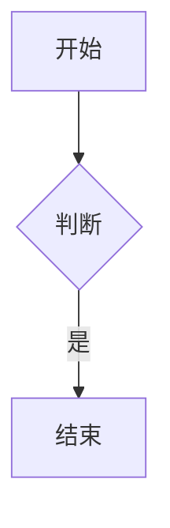

# Markdown 扩展参考

站点以 `marked` 的 GFM 为基础，并在 `useMarkdown.js` 中加入站点特有语法。
本文只描述**当前实现真实支持**的写法。

## 1. 基础语法

- 标题 `#` ~ `####`（目录只识别到三级，建议不超过 `###`）。
- 粗体 / 斜体 / 删除线 / 行内代码。
- 有序、无序列表；嵌套列表最多 3 空格缩进（渲染前会规范化）。
- 表格、引用块、分割线。
- 围栏代码块 ` ```lang `，支持 highlight.js 的语言高亮。
- 任务列表 `- [ ]` / `- [x]`（渲染后可交互，见第 5 节）。

## 2. 数学公式

```markdown
行内：$a^2 + b^2 = c^2$

块级：
$$
\int_0^1 x^2 \, dx
$$
```

- 由 KaTeX 渲染，仅在存在公式时动态加载。
- 公式内的 `*`、`_` 不会触发 Markdown 强调。
- 不在代码块中使用 `$` 公式，代码块内的内容会原样保留。

## 3. Mermaid 图表

````markdown

````

- 渲染失败时保留源码，不会白屏。
- 代码块工具条提供全屏查看。
- 图表的主题色继承站点样式，不建议在图表内写死白色背景。

## 4. Obsidian 图片嵌入

```markdown
![[樱花1.jpg]]
![[樱花1.jpg|樱花]]
![[子目录/图.png]]
```

| 写法 | 解析 |
| --- | --- |
| 裸文件名 | `/blogs/图片/<文件名>` |
| 带目录 | 相对路径原样使用 |
| 带 `assets/` 或 `blogs/` 前缀 | 原样使用 |
| 第二个 `|` 段 | 作为 alt 文本 |
| 非图片扩展名 | 保持原样（不转换） |

## 5. 任务清单

```markdown
- [x] 已完成的准备
- [ ] 待完成的事项
```

`useChecklist` 会把原生复选框替换为可点击样式，并：

- 插入「已完成 x / y」的进度条；
- 按文章维度把勾选状态写入 `localStorage`（键 `yb-checklist:<blogId>`）；
- 该状态只在本机有效，不会同步。

## 6. 习题块

站点支持一套方括号块，用于课程笔记中的自测题。

```markdown
[task]
题干：下列说法正确的是？

[question]下面哪个选项正确？[\question]

[options]
A. 选项一
B. 选项二
C. 选项三
[\options]

[answer]B[\answer]

[analysis]因为……所以选 B。[\analysis]
[\task]
```

### 6.1 结束标记（重要）

当前实现的结束标记是 **反斜杠**：`[\task]`、`[\options]`、`[\answer]`、`[\analysis]`、`[\question]`。
这与常见的 `[/task]` 不同，写成 `[/task]` 不会被识别。

### 6.2 `[options]` 的两种写法

显式字母：

```markdown
[options]
A. 快速排序
B) 归并排序
C：堆排序
[\options]
```

自动编号（按非空行顺序生成 A/B/C）：

```markdown
[options]
快速排序
归并排序
堆排序
[\options]
```

### 6.3 `[answer]` 的识别规则

| 写法 | 判定 |
| --- | --- |
| `B` | 单选 B |
| `A,C` 或 `AC` | 多选 |
| `答案：B` / `结论：B` / `Answer: B` | 单选 B |
| 首行以字母开头 | 取该字母 |

多选提交后会锁定选项并显示对错；统计由 `useAnswer` 维护。

### 6.4 `[analysis]`

`[analysis]` 会与相邻的 `[answer]` 合并为同一个答案面板，
常见顺序是 `[answer]` 后紧跟 `[analysis]`。

## 7. 内部引用

```markdown
参见 [[#内存管理]]。
```

- 仅支持**当前文章内**跳转。
- 标题文本必须与目标标题完全一致（不含 `#`）。
- 重复标题会由渲染器追加序号，引用仍按文本匹配。

## 8. 资源路径

| 写法 | 基准 |
| --- | --- |
| `` / `` | 当前 Markdown 文件所在目录 |
| `` | 站点根（自动补 `BASE_URL`） |
| `` | 站点根 |
| `` | 原样保留 |

## 9. 不建议使用的写法

- 原始 HTML 标签：经 `v-html` 输出，可能破坏页面结构或被浏览器截断。
- 内嵌 `<script>` / `<style>`：不会被信任，且会污染站点。
- 外部图床：链接失效后文章会出现空白图，优先本地资源。
- 四级以上标题：目录不展示，阅读层级也会混乱。

## 10. 导出行为

`ExportModal` 导出时会基于原始 Markdown 清理站点私有标记，
因此习题块、内部引用等语法在导出文件中可能被降级为普通文本。
